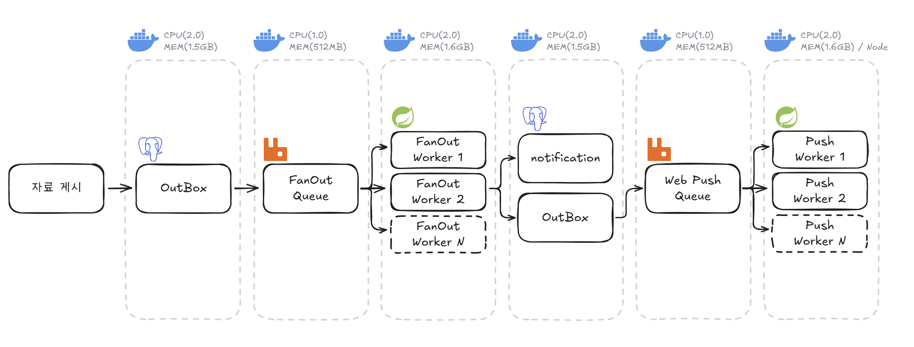
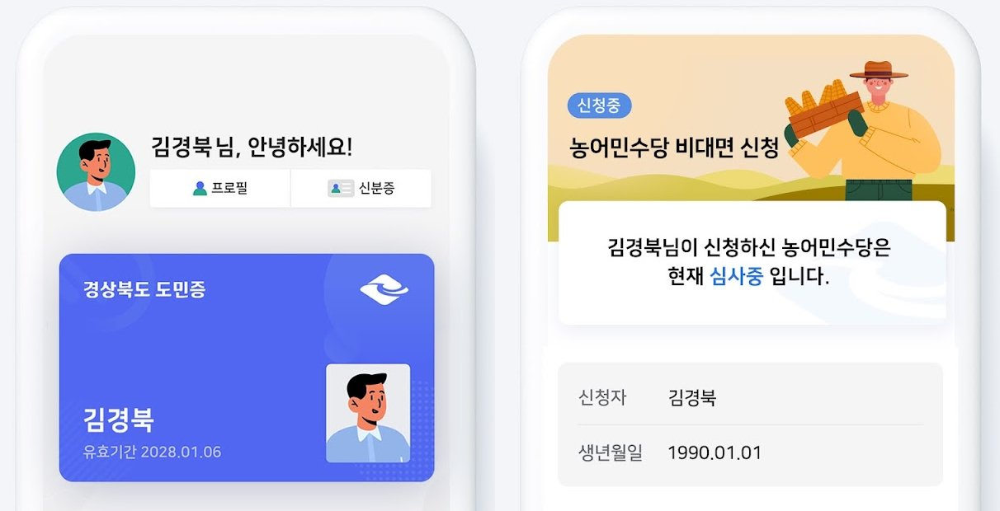

# 송정기

공공 모바일 서비스(사용자 약 20만 명) 백엔드 개발·운영 1년 7개월 
Java · Spring Boot · MySQL · PostgreSQL · Redis · RabbitMQ · Docker

- **61시간 21분 → 5분 48초** 웹 푸시 100만 건 발송
- **초당 10,000건** 디바이스 텔레메트리(위치, 배터리, 네트워크 상태 등의 정보) 적재
- **10초 이상 → 0.5초 이내** 관리자 조회 응답
- **8개 항목** 보안 취약점 조치, 재진단 통과

 

## [집현전] 실시간 라이브 강의 플랫폼 (SSAFY 6인, 우수상)

<table>
<tr>
<td width="48%" valign="top"></td>
<td valign="top">

Spring Boot · PostgreSQL · Redis Streams · LiveKit · WebSocket

- Backend & Infra 담당
- 라이브 강의: LiveKit SFU 자체 호스팅, Egress 녹화 → HLS 다시보기
- 실시간 자막: STT 결과를 Redis Streams로 받아 저장 후 WebSocket으로 전달
- 실시간 채팅: STOMP over WebSocket
- 배포: Docker, nginx
- 웹 푸시 알림

</td>
</tr>
</table>
 

## [집현전 확장] 100만 명 웹 푸시 발송 시스템 (개인)

<table>
<tr>
<td width="48%" valign="top"></td>
<td valign="top">

Spring Boot · PostgreSQL · RabbitMQ · Docker · Prometheus · Grafana

- 발송 시간 **61시간 21분 → 5분 48초**
- 게시와 발송 분리: Transactional Outbox, RabbitMQ
- HTTP/2 멀티플렉싱으로 최대 800건 동시 발송
- 암호 객체 재사용: 건당 5.95ms → 0.36ms
- DB OOM → 커서 기반 분할 처리
- [개선 과정 문서](https://portfolio.thdwjdrl.com/notification/)

</td>
</tr>
</table>
 

## [Locus] 디바이스 위치·상태 데이터 수집 및 모니터링 서버 (개인)

<table>
<tr>
<td width="48%" valign="top"></td>
<td valign="top">

Spring Boot · TimescaleDB · Redis Streams · MQTT · k6 · Docker

- **초당 10,000건**의 디바이스 텔레메트리 데이터를 4코어 서버에서 63분간 유실 없이 적재 (개선 전 초당 33건)
- 디스크 I/O 병목 확인 → 배치 INSERT, TimescaleDB, 저장 워커 병렬화
- [코드](https://github.com/thdwjdrl401/locus) · [부하 테스트 결과](https://github.com/thdwjdrl401/locus/blob/main/docs/PERFORMANCE.md)

</td>
</tr>
</table>
 

## [모이소] 경상북도 모바일 도민증

<table>
<tr>
<td width="48%" valign="top"></td>
<td valign="top">

Spring Boot · JPA · MySQL · Flutter

- Spring Boot API 서버, 관리자 웹, Flutter 앱 개발·운영
- N+1 쿼리 해결로 관리자 조회 **10초 이상 → 0.5초 이내**
- 외부 앱·웹 취약점 진단 지적 사항 중 8개 항목 조치, 재진단 통과
- [Google Play](https://play.google.com/store/apps/details?id=com.iconloop.gb_mydata) · [App Store](https://apps.apple.com/kr/app/id1668273536) · [기술 회고](https://github.com/thdwjdrl401/dev_retrospective)

</td>
</tr>
</table>

 

## 기술 노트

- **[Spring Boot는 어떤 ApplicationContext를 사용할까](https://github.com/SSAFY-CS-STUDY-15th/SongJeongKi/blob/java/from-browser-to-spring-process/Spring%20Boot%EB%8A%94%20%EC%96%B4%EB%96%A4%20ApplicationContext%EB%A5%BC%20%EC%82%AC%EC%9A%A9%ED%95%A0%EA%B9%8C.md)**
  - Spring Boot가 실제로 어떤 ApplicationContext를 쓰는지 궁금해 내부 코드를 따라갔습니다.
  - 따라가다 보니 AOT 환경에서는 컨텍스트를 구성하는 방식이 달라진다는 점을 발견했습니다.
  - 직접 확인하려고 일반 JVM, AOT JVM, Native Image 세 방식으로 빌드해 실행을 비교했습니다.
- **브라우저의 요청은 스프링에 오기 전에 어디를 지날까** ([1편](https://github.com/SSAFY-CS-STUDY-15th/SongJeongKi/blob/java/from-browser-to-spring-process/%5BJAVA%5D-%EB%B8%8C%EB%9D%BC%EC%9A%B0%EC%A0%80%EC%9D%98%20%EC%9A%94%EC%B2%AD%EC%9D%B4%20%EC%8A%A4%ED%94%84%EB%A7%81%EA%B9%8C%EC%A7%80%20%EC%98%A4%EA%B8%B0%EA%B9%8C%EC%A7%80.md) · [2편](https://github.com/SSAFY-CS-STUDY-15th/SongJeongKi/blob/java/from-browser-to-spring-process/%5BJAVA%5D-%EB%B8%8C%EB%9D%BC%EC%9A%B0%EC%A0%80%EC%9D%98%20%EC%9A%94%EC%B2%AD%EC%9D%B4%20%EC%8A%A4%ED%94%84%EB%A7%81%EA%B9%8C%EC%A7%80%20%EC%98%A4%EA%B8%B0%EA%B9%8C%EC%A7%802.md))
  - 요청이 DispatcherServlet에 닿기 전에 어디를 지나는지 궁금해 Tomcat 11.0.21 소스 코드를 따라갔습니다.
  - Coyote, CoyoteAdapter, Catalina, Pipeline/Valve를 거치는 흐름을 정리했습니다.
  - 그 과정에서 `Request.recycle()`로 객체 상태를 초기화해 다음 요청에 재사용하는 구조를 확인했습니다.
