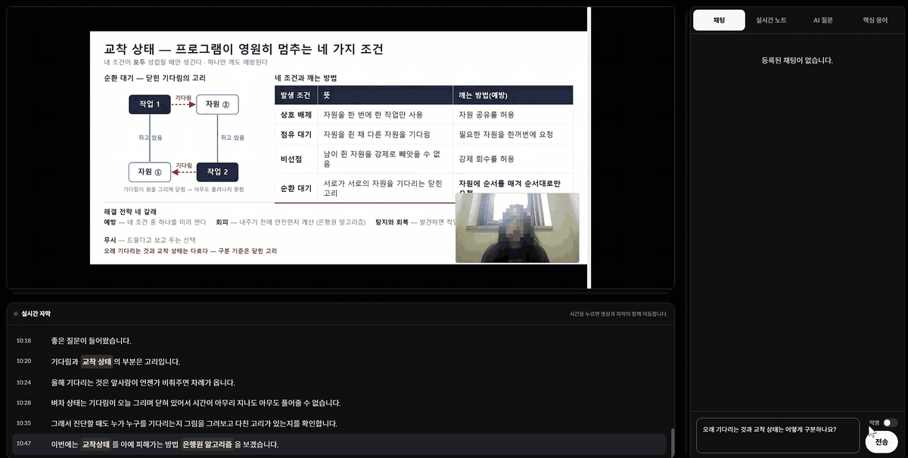
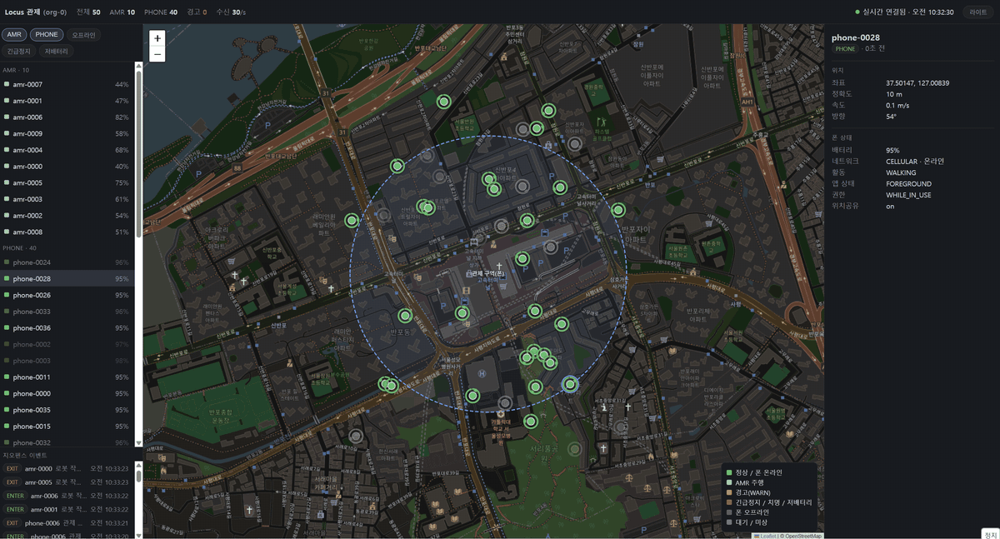

# 송정기 · 백엔드 개발자

**지표로 병목을 확인하고 구조를 바꿉니다**

(주)에즈넷 1년 7개월 · 공공 마이데이터 플랫폼 운영 · SSAFY 15기

      

## 집현전 · 실시간 라이브 강의 플랫폼

SSAFY 6인 · Backend & Infra · 우수상(3등)

- **웹 푸시 100만 건 발송** 61시간 21분 → 5분 48초 · [개선 과정](https://portfolio.thdwjdrl.com/notification/)
- **실시간 자막** Redis Streams Consumer Group, eventId 멱등 저장
- **미디어** LiveKit SFU 자체 호스팅

## Locus · 디바이스 위치·상태 데이터 수집 서버

개인 · [코드](https://github.com/thdwjdrl401/locus)

- **적재 처리량** 초당 33건 → 10,000건 · [측정 기록 11편](https://github.com/thdwjdrl401/locus/tree/main/docs/measurements)
- **설계 결정** 저장소, 메시징, 모듈 경계 · [ADR 8편](https://github.com/thdwjdrl401/locus/tree/main/docs/decisions)
- **기술** Redis Streams, TimescaleDB, MQTT, k6

## 실무 · 경상북도 모바일 도민증 외

(주)에즈넷 · 회사 코드 비공개 · [기술 회고](https://github.com/thdwjdrl401/dev_retrospective)

- **관리자 조회** 10초 이상 → 0.5초 이내 (N+1 제거)
- **보안 진단** 취약점 8개 항목 조치, 이행진단 통과
- **첨부파일 암호화** 서비스 중단 없이 AES/CBC 전환

## 기술 노트

- [Spring Boot는 어떤 ApplicationContext를 사용할까](https://github.com/SSAFY-CS-STUDY-15th/SongJeongKi/blob/java/from-browser-to-spring-process/Spring%20Boot%EB%8A%94%20%EC%96%B4%EB%96%A4%20ApplicationContext%EB%A5%BC%20%EC%82%AC%EC%9A%A9%ED%95%A0%EA%B9%8C.md)
- [브라우저의 요청은 스프링에 오기 전에 어디를 지날까](https://github.com/SSAFY-CS-STUDY-15th/SongJeongKi/blob/java/from-browser-to-spring-process/%5BJAVA%5D-%EB%B8%8C%EB%9D%BC%EC%9A%B0%EC%A0%80%EC%9D%98%20%EC%9A%94%EC%B2%AD%EC%9D%B4%20%EC%8A%A4%ED%94%84%EB%A7%81%EA%B9%8C%EC%A7%80%20%EC%98%A4%EA%B8%B0%EA%B9%8C%EC%A7%80.md)

## 연락

- thdwjdrl401@gmail.com
