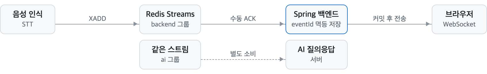
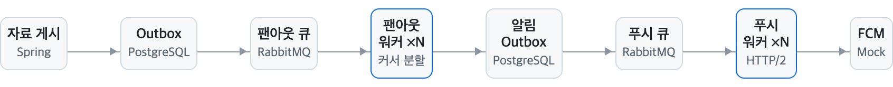
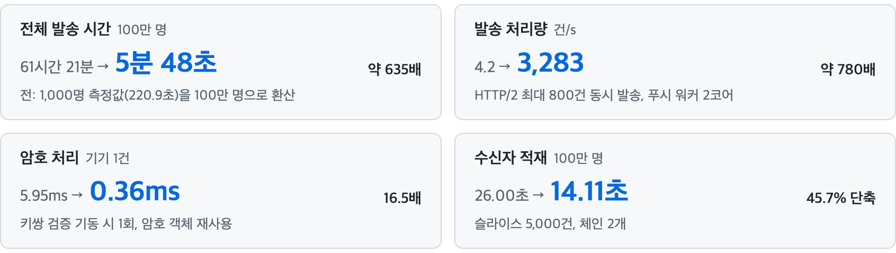
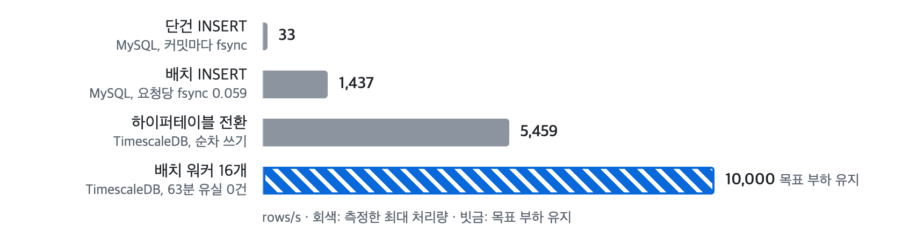

# 송정기 · 백엔드 개발자

**지표로 병목을 확인하고 구조를 바꿉니다**

- **경력**: (주)에즈넷 개발팀 1년 7개월 (2024.03 ~ 2025.09)
- **담당**: 공공 마이데이터 플랫폼 API 서버·관리자 웹·앱
- **현재**: SSAFY 15기 Java 트랙

        

## 실무 경력

### 모이소 · 경상북도 공공 마이데이터 플랫폼

Play 스토어 사용자 약 20만 명 · API 서버, 관리자 웹, Flutter 앱 주 담당 · 코드 비공개

- 관리자 조회 **10초 이상 → 0.5초 이내**
  - 원인: 근무상황표 조회의 N+1
  - 조치: 일괄 조회, 3단계 Map 인덱싱, 2단계 페이징
- 보안 취약점 **8개 항목 조치**, 이행진단 통과
  - 대표: 주민등록번호 평문 메모리 잔존
  - 조치: Frida 메모리 덤프로 재현 후 처리 구조 변경
- 첨부파일 암호화 **서비스 중단 없이 전환**
  - 조치: 4바이트 매직 넘버로 파일 포맷 판별
  - 기존 Base64 파일과 AES/CBC 파일 동시 처리

[실무 기술 회고](https://github.com/thdwjdrl401/dev_retrospective)

## 프로젝트

### 집현전 · 실시간 라이브 강의 플랫폼

SSAFY 6인 팀 · Backend & Infra · 우수상(3등) · 코드 비공개

<picture>
  <source media="(prefers-color-scheme: dark)" srcset="assets/caption-flow-dark.png">
  
</picture>

- **SFU 자체 호스팅**: LiveKit 기반 라이브 강의
- **실시간 자막**: Redis Streams 별도 Consumer Group
  - eventId 멱등키로 중복 저장 방지
  - DB 커밋 후 전송, 수동 ACK
- **웹 푸시 알림**: 아래 확장 프로젝트로 이어짐

### 집현전 확장 · 100만 명 웹 푸시 발송 시스템

개인 · 노트북 1대(물리 4코어), FCM Mock 서버(왕복 230ms) · 코드 비공개

<picture>
  <source media="(prefers-color-scheme: dark)" srcset="assets/push-flow-dark.png">
  
</picture>

<picture>
  <source media="(prefers-color-scheme: dark)" srcset="assets/push-results-dark.png">
  
</picture>

- 목표: 강의 자료 게시 후 **1분 내 발송**
- **게시와 발송 분리**: Transactional Outbox, RabbitMQ
  - 게시 API 응답 0.42초, 발송 완료를 기다리지 않음
- **DB OOM 해소**: 수신자 커서 기반 분할 조회
- **CPU 병목 해소**: 앱 CPU 376% / 한도 400%에서 시작
  - 키쌍 검증 기동 시 1회, 암호 객체 ThreadLocal 재사용
- **발송 대기 해소**: 공급자 왕복 230ms를 동시 발송으로 겹침
- 웹 푸시 1,097,488건 전부 성공 (Mock 서버 기준 유실·429·5xx 0건)
- 1분 내 처리에 필요한 물리 코어 **12개**로 산정

[개선 과정 문서](https://portfolio.thdwjdrl.com/notification/)

### Locus · 디바이스 위치·상태 데이터 수집 서버

개인 · 4코어 8GB 5400rpm HDD 단일 서버 · k6 부하 측정 · 코드 공개

<picture>
  <source media="(prefers-color-scheme: dark)" srcset="assets/locus-load-dark.png">
  
</picture>

- **초당 10,000건 63분 연속 적재**, 유실 0건
- **디스크 I/O 병목**: CPU 2~8%, 디스크 %util 97%
  - 배치 INSERT로 요청당 fsync 1.2 → 0.059
  - synchronous_commit 완화는 유실 위험으로 기각
- **랜덤 쓰기 감소**: TimescaleDB 하이퍼테이블
- **처리량 정체**: 배치 워커 16개 병렬화
- **데드락 제거**: TreeMap으로 락 획득 순서 고정

[코드](https://github.com/thdwjdrl401/locus) · [부하 테스트 결과](https://github.com/thdwjdrl401/locus/blob/main/docs/PERFORMANCE.md) · [설계 결정 기록](https://github.com/thdwjdrl401/locus/tree/main/docs/decisions)

## 기술 노트

- [Spring Boot는 어떤 ApplicationContext를 사용할까](https://github.com/SSAFY-CS-STUDY-15th/SongJeongKi/blob/java/from-browser-to-spring-process/Spring%20Boot%EB%8A%94%20%EC%96%B4%EB%96%A4%20ApplicationContext%EB%A5%BC%20%EC%82%AC%EC%9A%A9%ED%95%A0%EA%B9%8C.md)
  - AOT, Native Image 직접 빌드 비교
- [브라우저의 요청은 스프링에 오기 전에 어디를 지날까](https://github.com/SSAFY-CS-STUDY-15th/SongJeongKi/blob/java/from-browser-to-spring-process/%5BJAVA%5D-%EB%B8%8C%EB%9D%BC%EC%9A%B0%EC%A0%80%EC%9D%98%20%EC%9A%94%EC%B2%AD%EC%9D%B4%20%EC%8A%A4%ED%94%84%EB%A7%81%EA%B9%8C%EC%A7%80%20%EC%98%A4%EA%B8%B0%EA%B9%8C%EC%A7%80.md)
  - Tomcat 11 소스 코드로 요청 처리 흐름 추적

## 연락

- thdwjdrl401@gmail.com
