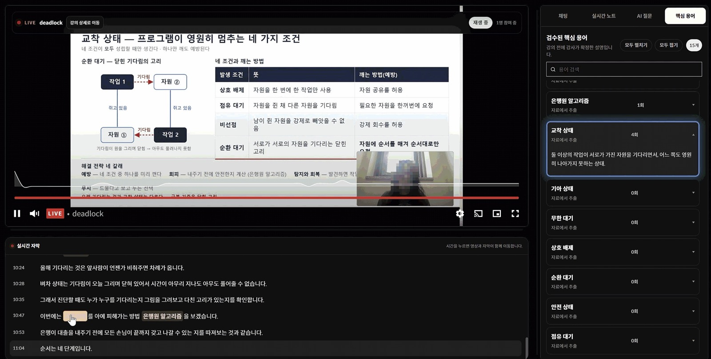

# 송정기

공공 모바일 서비스(사용자 약 20만 명) 백엔드 개발·운영 1년 7개월

Java · Spring Boot · MySQL · PostgreSQL · Redis · RabbitMQ · Docker

- **61시간 21분 → 5분 48초** 웹 푸시 100만 건 발송
- **초당 10,000건** 위치 데이터 저장
- **10초 이상 → 0.5초 이내** 관리자 조회 응답
- **8개 항목** 보안 취약점 조치, 재진단 통과

---

### [집현전] 실시간 라이브 강의 플랫폼 (SSAFY 6인, 우수상)

Spring Boot · PostgreSQL · Redis Streams · LiveKit · WebSocket

<table>
<tr>
<td width="48%"></td>
<td>

- Backend & Infra 담당
- WebRTC SFU(LiveKit) 자체 호스팅
- 실시간 자막: STT 결과를 Redis Streams로 받아 저장 후 WebSocket으로 전달
- 웹 푸시 알림

</td>
</tr>
</table>

### [집현전 확장] 100만 명 웹 푸시 발송 시스템 (개인)

Spring Boot · PostgreSQL · RabbitMQ · Docker · Prometheus · Grafana

- 수신자 100만 명 발송 시간 **61시간 21분 → 5분 48초**
- 강의 자료 게시와 알림 발송 분리: Transactional Outbox, RabbitMQ (게시 API 응답 0.42초)
- 푸시 워커 분리, HTTP/2 멀티플렉싱으로 최대 800건 동시 발송
- Web Push 암호화 객체 재사용: 건당 5.95ms → 0.36ms
- 수신자 100만 명 일괄 조회 시 DB OOM → 커서 기반 분할 처리, `INSERT ... SELECT`
- [개선 과정 문서](https://portfolio.thdwjdrl.com/notification/)

### [Locus] 디바이스 위치·상태 데이터 수집 및 모니터링 서버 (개인)

Spring Boot · TimescaleDB · Redis Streams · MQTT · k6 · Docker

<table>
<tr>
<td width="48%"></td>
<td>

- 4코어 서버에서 위치 데이터 **초당 10,000건**을 63분간 유실 없이 저장 (개선 전 초당 33건)
- 디스크 I/O 병목 확인 → 배치 INSERT, TimescaleDB, 저장 워커 병렬화
- [코드](https://github.com/thdwjdrl401/locus) · [부하 테스트 결과](https://github.com/thdwjdrl401/locus/blob/main/docs/PERFORMANCE.md)

</td>
</tr>
</table>

### [모이소] 경상북도 모바일 도민증

Spring Boot · JPA · MySQL · Flutter

- Spring Boot API 서버, 관리자 웹, Flutter 앱 개발·운영
- N+1 쿼리 해결로 관리자 조회 **10초 이상 → 0.5초 이내**
- 외부 앱·웹 취약점 진단 지적 사항 중 8개 항목 조치, 재진단 통과
- [기술 회고](https://github.com/thdwjdrl401/dev_retrospective)

---

### 기술 노트

**[Spring Boot는 어떤 ApplicationContext를 사용할까](https://github.com/SSAFY-CS-STUDY-15th/SongJeongKi/blob/java/from-browser-to-spring-process/Spring%20Boot%EB%8A%94%20%EC%96%B4%EB%96%A4%20ApplicationContext%EB%A5%BC%20%EC%82%AC%EC%9A%A9%ED%95%A0%EA%B9%8C.md)**

Spring Boot가 실제로 어떤 ApplicationContext를 쓰는지 내부 코드를 따라갔습니다. 그 과정에서 AOT 환경에서는 컨텍스트를 구성하는 방식이 달라진다는 점을 확인했고, 일반 JVM, AOT JVM, Native Image 세 방식을 직접 빌드해 실행을 비교했습니다.

**브라우저의 요청은 스프링에 오기 전에 어디를 지날까** ([1편](https://github.com/SSAFY-CS-STUDY-15th/SongJeongKi/blob/java/from-browser-to-spring-process/%5BJAVA%5D-%EB%B8%8C%EB%9D%BC%EC%9A%B0%EC%A0%80%EC%9D%98%20%EC%9A%94%EC%B2%AD%EC%9D%B4%20%EC%8A%A4%ED%94%84%EB%A7%81%EA%B9%8C%EC%A7%80%20%EC%98%A4%EA%B8%B0%EA%B9%8C%EC%A7%80.md) · [2편](https://github.com/SSAFY-CS-STUDY-15th/SongJeongKi/blob/java/from-browser-to-spring-process/%5BJAVA%5D-%EB%B8%8C%EB%9D%BC%EC%9A%B0%EC%A0%80%EC%9D%98%20%EC%9A%94%EC%B2%AD%EC%9D%B4%20%EC%8A%A4%ED%94%84%EB%A7%81%EA%B9%8C%EC%A7%80%20%EC%98%A4%EA%B8%B0%EA%B9%8C%EC%A7%802.md))

Tomcat 11.0.21 소스 코드에서 Coyote, CoyoteAdapter, Catalina, Pipeline/Valve를 거쳐 DispatcherServlet까지 요청 흐름을 추적했습니다. `Request.recycle()`로 객체 상태를 초기화해 다음 요청에 재사용하는 구조를 확인한 뒤로, 객체의 생성 비용과 생명주기를 함께 고려하게 되었습니다.
